# SC Shard Status

A free tool for Star Citizen players that tells you, in plain English, how healthy the shard you're on is and what's gone wrong when something breaks.

It reads two things the game already gives you: the debug overlay (`r_displayinfo 3`) and Game.log. From them it works out:

- **Shard health right now.** Each shard gets a short name like AU-20 or EU-410 (region and shard number). A 0-100 score with server fps, players on the shard and on your server, ping, packet loss, hitches and server restarts, and a sentence that says what it means for you, plus where you are in the game's own words and which area your server runs.
- **What's gone wrong?** One button. It checks the last 10 minutes to 4 hours of the log (earlier sessions included) against a library of known issues and explains what it finds, with fixes. It joins facts together: if a contract wants an item and the game has just logged a cargo error for that exact item, it tells you that's why the delivery isn't counting.
- **Timeline.** What happened, in order: quantum jumps, arrivals, armistice zones, ships retrieved, contracts, freight elevator, loading, disconnects and crashes, with place names from the game. Tick Details for the raw log lines.
- **Issue Council drafts.** Each finding comes with a report laid out box by box like the Issue Council form and inside its limits: title, the exact game version (`LIVE 4.10.2 / 4.10.2-live.12913470`), a suggested category and severity, steps to reproduce from your timeline, what happened, what should have happened and any workaround. It names exactly where you were (place, planet or moon, system, shard and server) with the server's fps at the time, and starts "What were you doing?" for you from the log. If players have already linked an Issue Council report on verseshards.com, it takes you there and writes your contribution instead. A folder with your Game.log and screenshots from around that time is one click away.
- **Mark this moment.** Something just went wrong? Press the button, or a hotkey you pick (Ctrl+Alt+M, say), and keep playing. Later, "What's gone wrong?" looks at exactly that moment.
- **Copy for global chat.** Short lines about your shard (a quiet server, one that's struggling) to paste into chat in game.
- **Groups.** Post a recruiting or looking-for-group notice on verseshards.com without leaving the game, and see who's keen to join. Got jumped? Report pirate activity in the area (never the exact spot) with one click.
- **History.** Every shard you've been on with its server fps and population, past sessions with load times, disconnects, contracts and crashes, and server fps by time of day.
- **My PC.** Your hardware and the game's own CPU and GPU test results from every launch, plus your frame rate by location.

**Live community board:** https://verseshards.com shows the health of every shard players are reporting from, and a page for every known issue with Issue Council links, workarounds and votes.

Finding this useful? A star on GitHub helps other players find it and trust it.

**Coming soon: org tools.** Plan org events, pick the healthiest shard and server for them from live readings, and rally your members to the right place at the right time.

By Aurelius_Draco ([add me as a friend](https://robertsspaceindustries.com/citizens/Aurelius_Draco), [Spectrum thread](https://robertsspaceindustries.com/spectrum/community/SC/forum/50172/thread/sc-shard-status-free-app-that-scores-your-shard-s-/575329)). Help wanted: testers with 1440p, 4K or ultrawide screens, and moderators: https://verseshards.com/help. Also by me: [SC Inventory Tracker](https://github.com/Aurelius-Draco/sc-inventory-tracker), which keeps track of what you've stored at every station.

## What it looks like

These are from real Game.logs with every name, ID and address swapped for made-up ones, and made-up overlay readings.

**A healthy shard.** About 20 server fps is normal on 4.10.

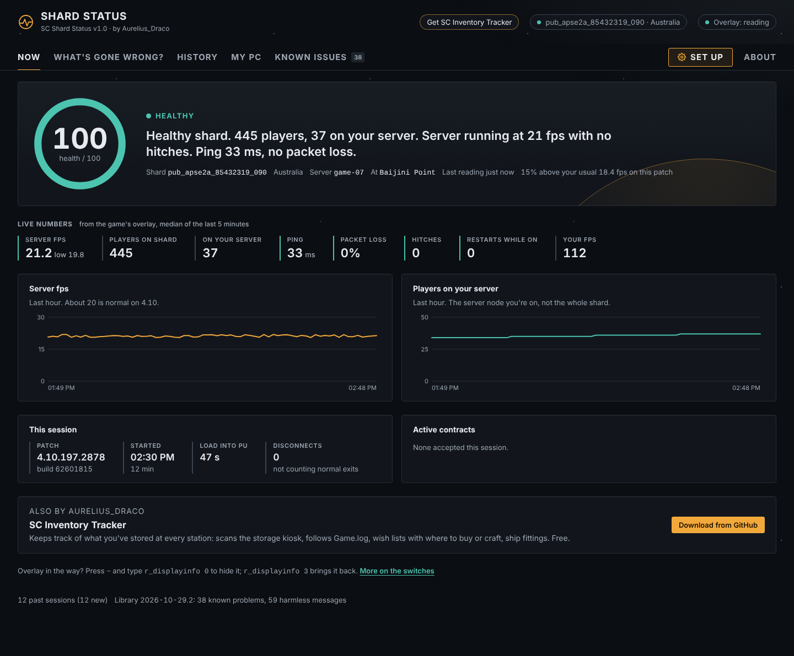

**Struggling.** The server has slowed down, ping is up and there are hitches. It tells you what that means in game.

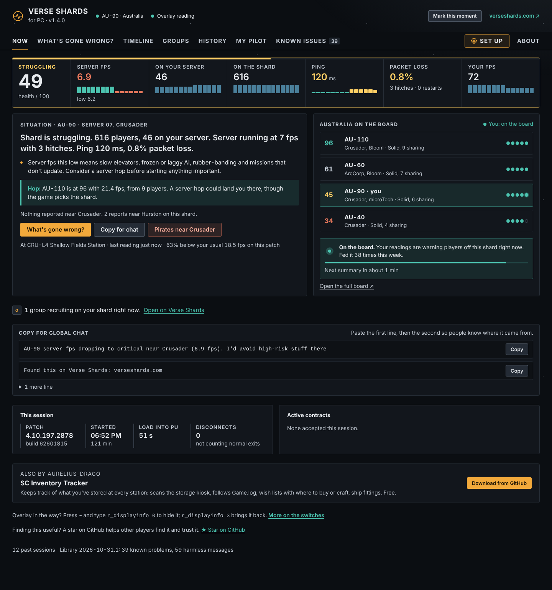

**In a bad way.** Server fps in single figures, a server restart while you were on it, packet loss. Time for a server hop.

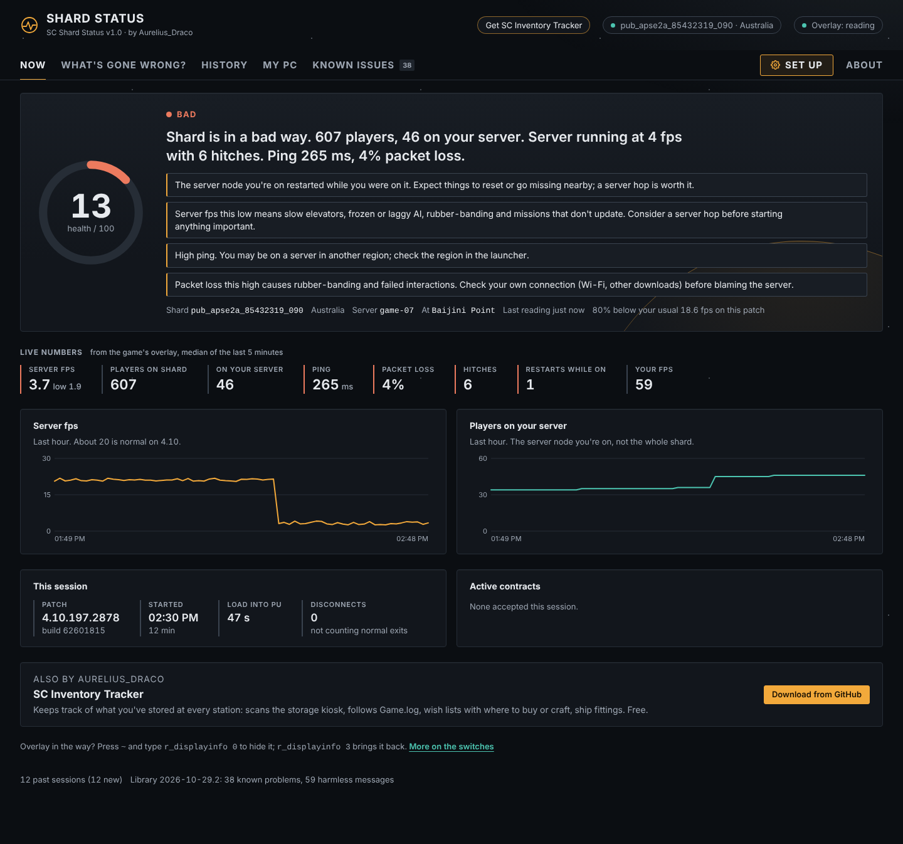

**What's gone wrong?** A contract whose deliveries never counted, the slow server, items stuck in a freight elevator after a server change, a disconnect during loading, each with what it means and what to do.

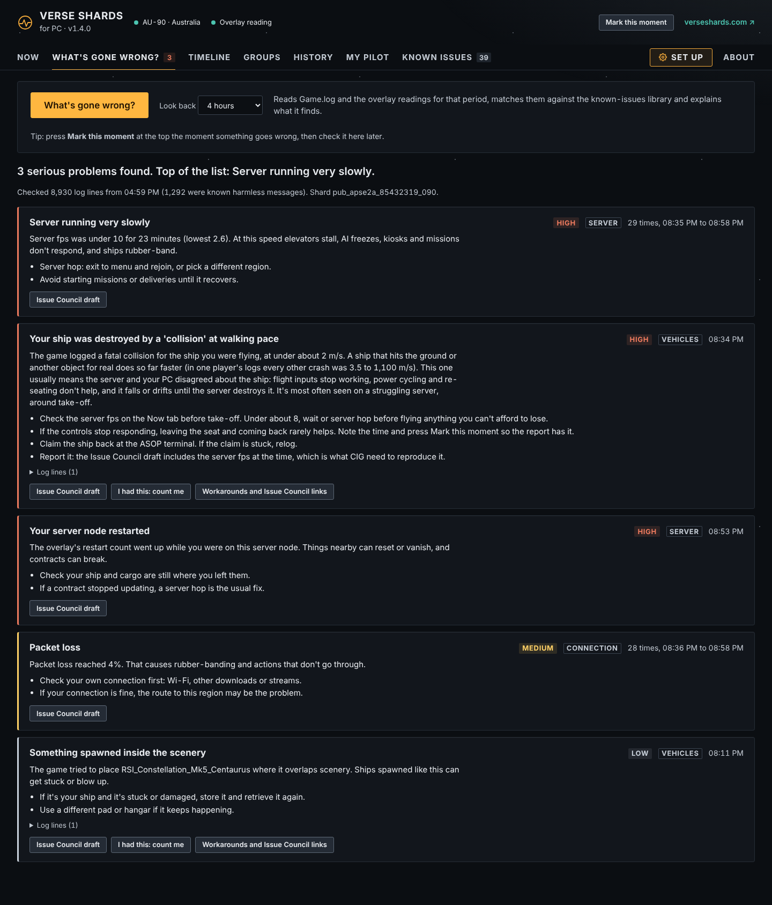

**Issue Council draft.** Every part has its own Copy button, so you paste each one straight into the matching box.

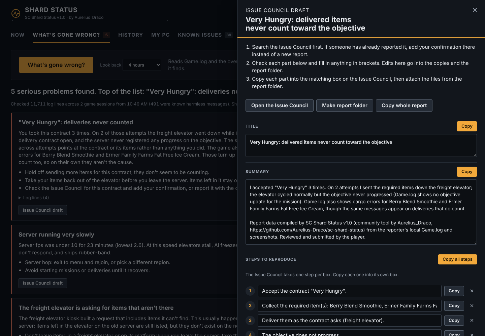

<details><summary>More: History, My PC, Known issues, Set up, light theme, narrow window</summary>

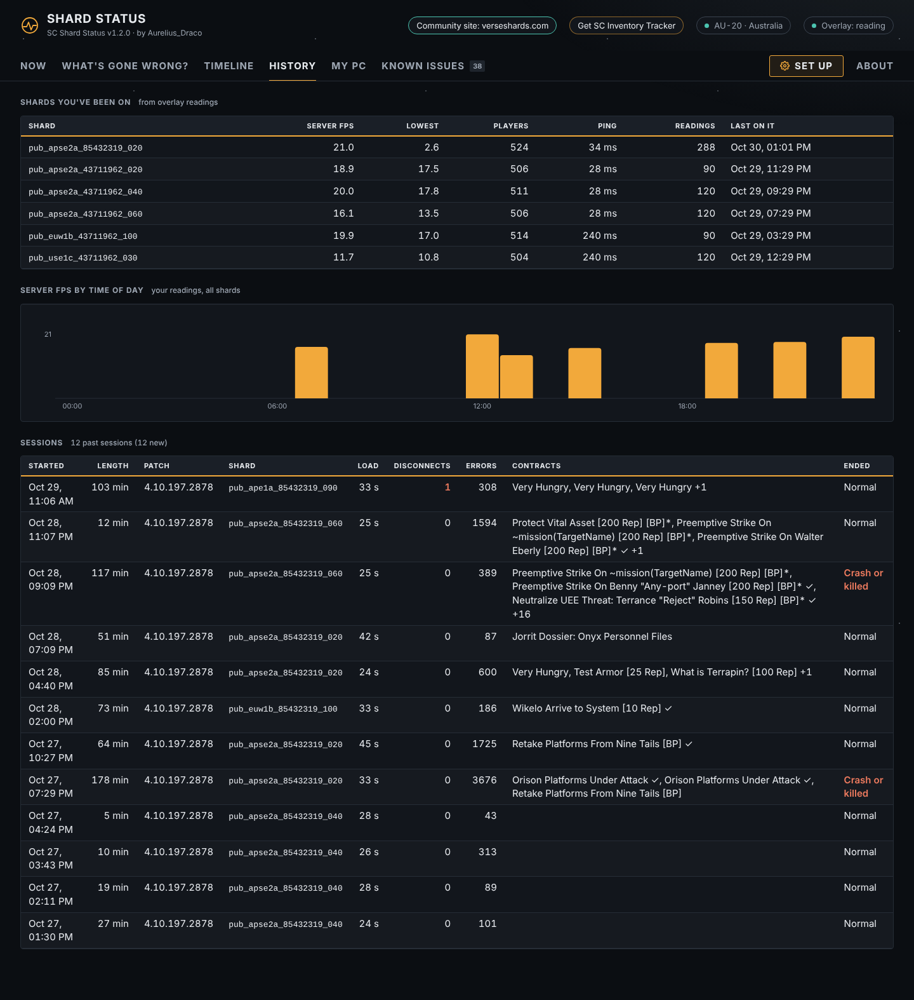
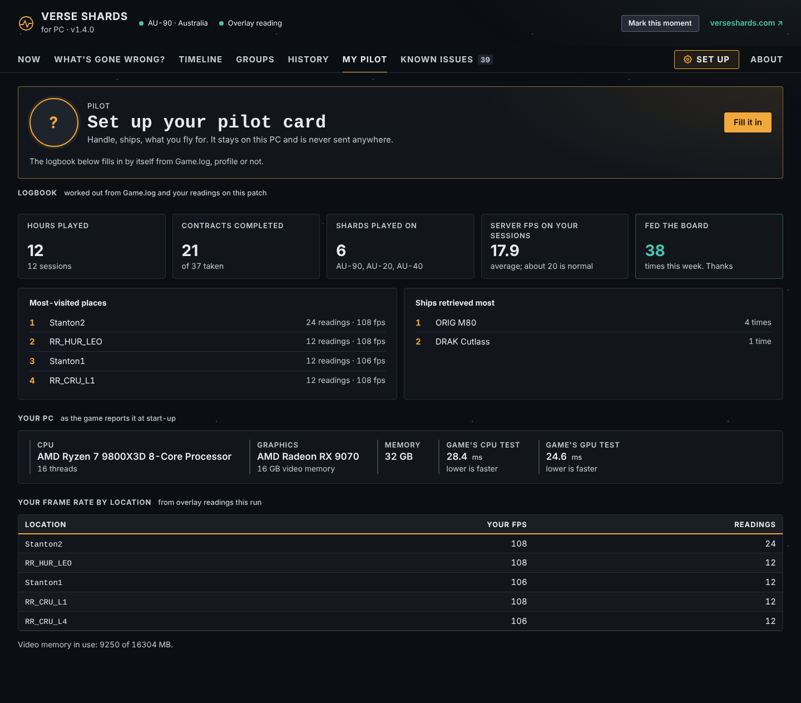
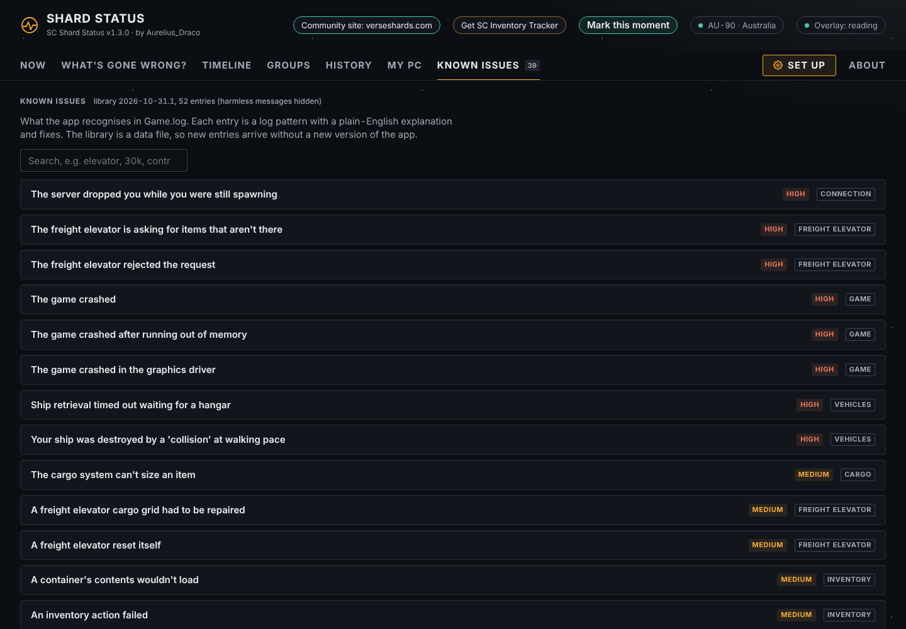
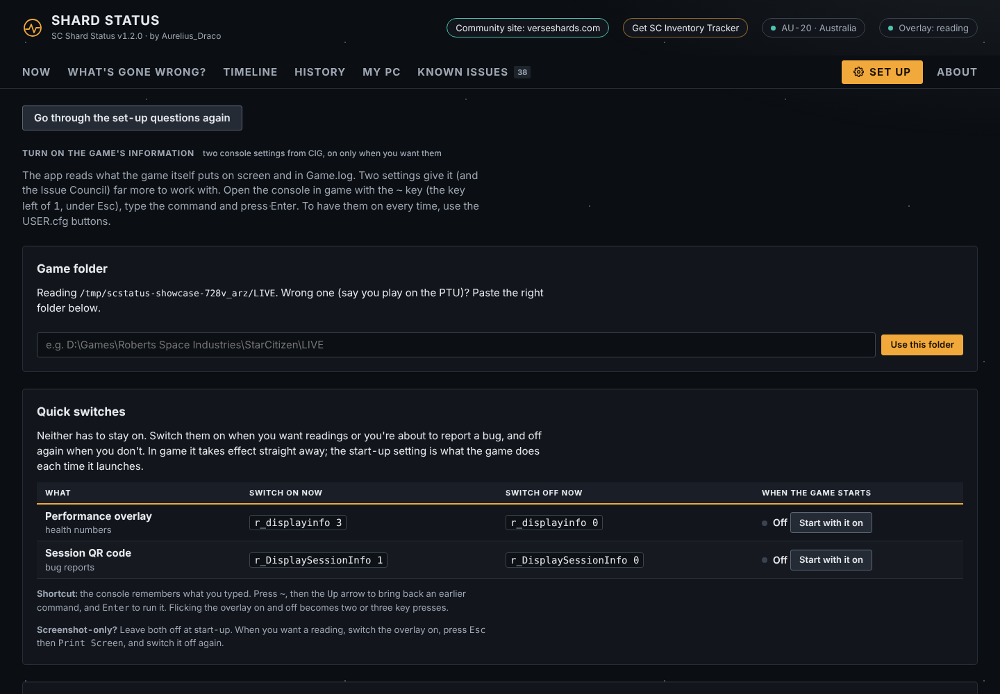
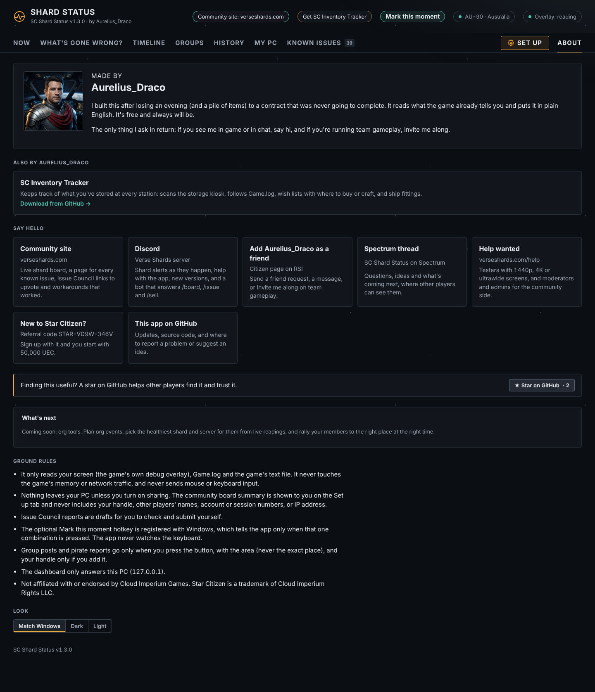
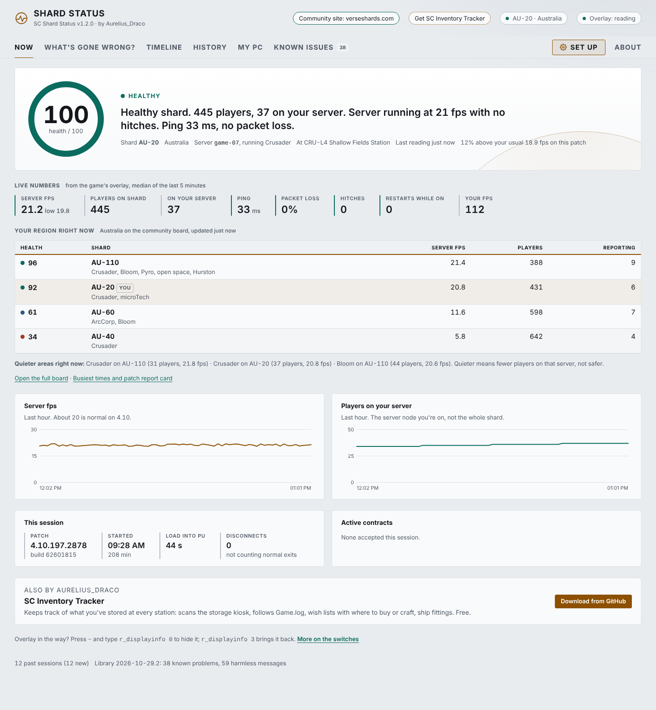
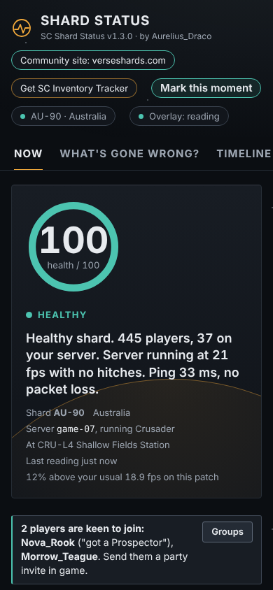

</details>

## Install (Windows)

1. Download **SC-Shard-Status-Setup-x.y.exe** from the latest [release](https://github.com/Aurelius-Draco/sc-shard-status/releases/latest) (or [verseshards.com/app](https://verseshards.com/app)) and run it. It installs just for you, so no admin password is needed.
2. Windows may show "Windows protected your PC" the first time, because the app is new and not from a big publisher. Click **More info**, then **Run anyway**.
3. Start **SC Shard Status** from the Start menu or desktop. The dashboard opens in your browser.

New versions: the app says so on its dashboard and updates itself with one click, keeping your settings and history. Your settings, readings and reports live in `%LOCALAPPDATA%\SC Shard Status`; uninstalling asks whether to keep them. Used the zip version before? The installed app finds it on first start and brings everything across.

<details><summary>Run it from source instead (Python 3.12 or 3.13)</summary>

Download `SC-Shard-Status-x.y.zip` from the same release, unzip it anywhere and double-click **Setup.bat**. If you don't have Python, Setup tells you the one command to install it. This copy keeps its data in its own `data` folder and points you to the installer when a new version is out.

</details>

It finds the game by itself in most cases: it checks next to its own folder, the usual install places on every drive, and folders one or two levels deep (like `D:\Games\RSI\StarCitizen\LIVE`). If your install is somewhere unusual, start Star Citizen and the app picks the folder up from the running game, or paste the folder on the **Set up** tab. It's the `StarCitizen\LIVE` folder, the one with `Bin64` and `Game.log` in it.

## Turn on the game's information

The **Set up** tab in the app walks through this, with buttons that add the settings to USER.cfg for you.

In game, open the console with `~` (the key left of 1) and type:

```
r_displayinfo 3
r_DisplaySessionInfo 1
```

- `r_displayinfo 3` shows the performance block in the top right: server fps, players on the shard and on your server, ping, packet loss, hitches, restarts, your fps and location. The live health numbers come from this; Game.log doesn't have them. Levels 2, 3 and 4 show the same block in 4.10.
- `r_DisplaySessionInfo 1` shows the session QR code (also in the game's Graphics settings). It's optional and most players leave it off: switch it on when you're about to report a bug, because CIG can find your session from it. Blur it in screenshots you post publicly.

Neither has to stay on: `r_displayinfo 0` and `r_DisplaySessionInfo 0` switch them off again, and the console remembers what you typed (press `~`, then the Up arrow, then Enter), so flicking them on and off is a couple of key presses. The Set up tab has the full list of switches.

To have the overlay on every time, add `r_displayinfo = 3` (and, if you want it, `r_DisplaySessionInfo = 1`) to `USER.cfg` in your `StarCitizen\LIVE` folder (the Set up tab does it for you and keeps a backup).

## Live or screenshots

- **Live** (default): the app reads the overlay corner of the screen every 5 seconds while the game is in front. You get the health score, charts and warnings.
- **Screenshots**: press `Print Screen` in game and any screenshot with the overlay on it becomes a reading. Nothing watches your screen; you just get a reading each time you press the key. Turn live reading off on the Set up tab if you prefer this.

Without the overlay the app still works from Game.log: sessions, shards, disconnects, contracts, crashes and "What's gone wrong?". You just don't get the health numbers.

## Tips for clean readings

- **Dark behind the text reads best.** The overlay is thin light text; over the sun, a bright planet, snow or a white wall it washes out and that reading is skipped. Face something dark when you want a reading.
- **For screenshots, press Esc first.** The game menu darkens the screen behind the overlay; then press Print Screen. The game keeps running while the menu is open.
- **Keep the top right corner clear** of other overlays (Discord, Steam, NVIDIA or AMD counters, RivaTuner).
- **Turn off Chromatic Aberration and Film Grain** in the game's Graphics settings.
- **1440p or higher** reads every value reliably. At 1080p the main numbers read fine, but the odd small value can be misread; the app uses the middle value over a few minutes, so one bad reading doesn't change the score.
- **Main monitor**, or set `monitor` (2, 3 and so on) in `config.json` in the app's data folder: `%LOCALAPPDATA%\SC Shard Status` for the installed app, or the `data` folder of a copy run from source.

## What the numbers mean

| | Healthy (4.10) | Trouble |
|---|---|---|
| Server fps | about 20 | under 10: elevators stall, AI freezes, missions stop updating |
| Ping | under 80 ms | over 250 ms: probably a server in another region |
| Packet loss | 0% | 2% or more: rubber-banding, actions that don't go through |
| Server restarts | no change | the count goes up while you're on it: the server node you're on restarted |

Players on shard is everyone on the shard; on your server is the server node handling your area. A shard is made of several server nodes.

## Ground rules

- It only reads your screen (the game's own overlay), Game.log and the game's text file. It never touches the game's memory or network traffic, and never sends mouse or keyboard input.
- Nothing leaves your PC unless you turn on sharing. The dashboard only answers this PC (127.0.0.1).
- When sharing is on, the app sends one summary every 5 minutes and shows you exactly what it sent. It never includes your handle, other players' names, account or session numbers, file paths or your IP address.
- Issue Council reports are drafts. You check them and submit them yourself. Each one ends with a line saying it was compiled by this tool.
- The optional Mark this moment hotkey is registered with Windows, which tells the app only when that one combination is pressed. The app never watches the keyboard.
- Group posts and pirate reports go only when you press the button, with the area (never the exact place), and your handle only if you add it. Posts are deleted from the site when they end.
- App error reports are off unless you say yes: where in the app it went wrong and the error, with file paths cut down to the file name and anything in quotes taken out.
- Not affiliated with or endorsed by Cloud Imperium Games. Star Citizen is a trademark of Cloud Imperium Rights LLC.

## Known issues library

What the app recognises lives in `scstatus/library/issues.json`: each entry is a log pattern, a plain-English explanation, fixes and a suggested Issue Council title. It's data, not code, so new entries don't need a new version of the app: with library updates on (asked on first start), the app fetches the newest copy from verseshards.com every 6 hours. See [docs/library.md](docs/library.md) to add one, or open an issue with the log lines and what was happening.

Something the app doesn't recognise? On the "What's gone wrong?" tab, **Send for review** shows you exactly what would be sent (names and numbers already replaced with placeholders), then sends it to the review queue. The answer shows up under **Your reviews**, and the library gets a new entry so everyone benefits.

## Pop-up alerts

Optional (asked on first start), with or without a sound: a Windows notification when the server's fps falls off a cliff, the server you're on restarts, packet loss climbs, you're disconnected with an error, or a known problem turns up in Game.log, such as contract deliveries not counting. Each kind at most once every 10 minutes. Windows holds notifications back while a full-screen game is in front, so borderless window mode or a second screen works best; the sound plays either way.

## Community board

https://verseshards.com · Discord: https://discord.gg/8kH5pfHYbe

- **Shard board:** live health for every shard players are reporting from, best first in each region, so you know where to server hop.
- **Common in-game issues right now:** known Star Citizen problems two or more players hit in the last 2 hours, under the 24-hour history.
- **Known issues:** a page for each issue the app recognises. Press "I had this too", add the Issue Council report so others can upvote it, and post workarounds that others mark as worked or didn't work. After a patch, each issue says whether it's still happening on the new build. The app's "What's gone wrong?" links each finding to its page.
- **Servers and areas:** open a shard to see each of its game servers, how many players are on it and which areas it runs (a planet, jump point or open space). Each region lists its quieter and busier areas right now. Quieter means fewer players, not safer.
- **Trends:** busiest and quietest times for each region (in your own time zone), a report card for each patch (server fps, disconnects with 30xxx errors, crashes, load times, restarts) and which issues are rising or falling, plus every shard and server seen in the last 30 days.
- **Trade:** the most profitable trade routes from [UEX](https://uexcorp.space)'s crowdsourced prices, beside how busy each end's server is, and **Where to sell**: who's buying what you carry, how full each terminal is, and a risk read that includes recent pirate reports. In Discord, `/sell`.
- **Copy for global chat** lines on the board and Where to sell.
- **RSI status:** when RSI's own status page reports a problem, the board and the app say so.
- Scores from one player are marked as a first look; more players reporting means a score you can trust.
- Two switches in the app, both asked on first start: **Show other shards** (sends nothing about you) and **Share my readings**. Sharing sends a summary every 5 minutes (shard, server node, the area your server runs but never the exact place, server fps, players, ping rounded to 10 ms, packet loss, known-issue ids, game build, random install id, screen size and counts of how cleanly the overlay was read) and, after each session, its build, length, load time, whether it crashed and any disconnect error codes with the game's wording for them (letters only). Never your handle, other players' names or anything that identifies you.

## For developers

```
python status.py                 live mode with the dashboard
python status.py --check         what's gone wrong, printed
python status.py --check --file "logbackups\Game Build(...).log" --minutes 0
python -m pytest -q tests
python tools/demo.py "<StarCitizen LIVE folder>"    dashboard on copied logs with made-up readings
python tools/showcase.py "<StarCitizen LIVE folder>"  the screenshots in docs/screenshots (names and IDs swapped for made-up ones)
```

MIT licence. See [THIRD_PARTY.md](THIRD_PARTY.md) for the libraries it uses.
